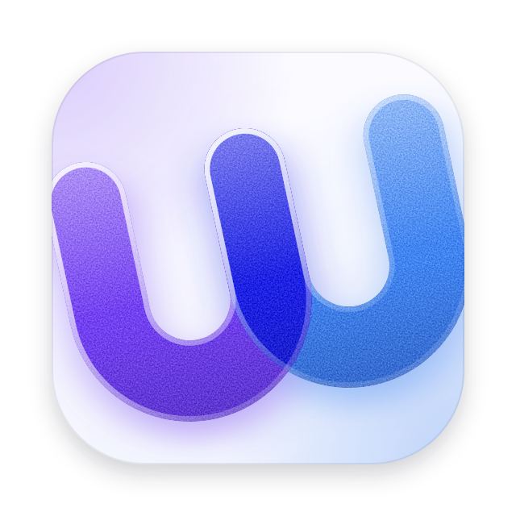
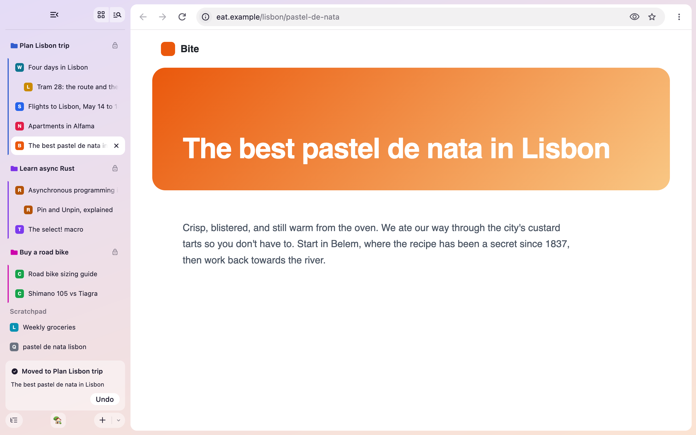
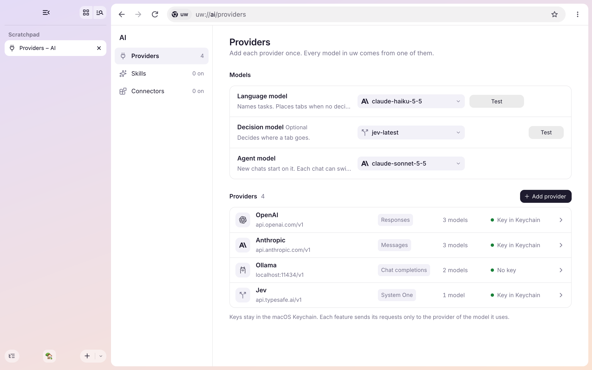
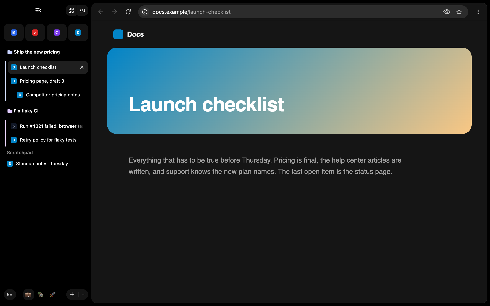
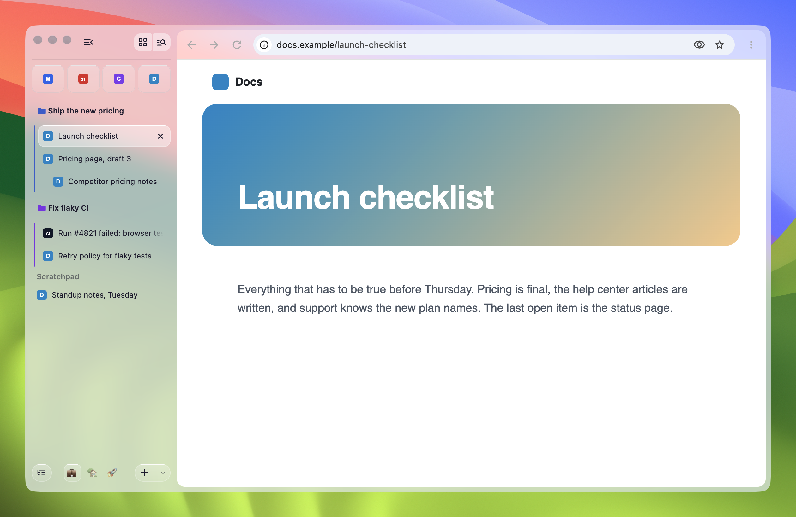

<p align="center">
  <picture>
    <source media="(prefers-color-scheme: dark)" srcset="docs/assets/logo-dark.svg">
    
  </picture>
</p>

<h1 align="center">uw browser</h1>

<p align="center"><strong>ur web, ur way</strong></p>

<p align="center">A Chromium browser for macOS that keeps your tabs organized for you.</p>

> [!WARNING]
> **uw is in early development.** Features are unfinished, things break, and behavior changes from week to week. Don't trust it with browsing data you care about.



## Tabs that organize themselves

Open tabs the way you always do. uw files each one into the task it belongs to.

- A task is a Chromium tab group. A page you open from another page nests under it.
- [Jev](https://typesafe.ai), a decision model from TypeSafe, decides where each tab goes and how sure it is. uw moves a tab only when the model is sure enough, and you set how sure on the settings page.
- Tabs that fit no task wait in the Scratchpad. A page that starts something new gets a task of its own, named by your language model.
- Every move shows a card with Undo. Option+Cmd+Z undoes it too.
- It is off until you pick a model and turn it on. uw then sends each tab's title, address, and a short excerpt of its text to that model.

## Bring your own key

uw has no account and no AI service of its own. Add the providers you already use, and uw talks to them directly.

- OpenAI, Anthropic, OpenRouter, Vercel AI Gateway, Ollama, Jev, or any other address with a compatible API.
- Keys stay in the macOS Keychain.
- Pick a model for each job: a decision model places tabs, a language model names tasks, and an agent model runs chats. Each sends its requests only to its own provider.
- Use Ollama to keep everything on your Mac.



## Vertical tabs and workspaces

uw looks and works like Arc, built on Chromium.

- Tabs are always vertical, in a sidebar tinted with a theme you pick.
- Workspaces keep work and personal browsing apart. Switch from the foot of the sidebar, or swipe.
- Pinned tabs sit as tiles at the top of the sidebar, shared by every window.
- Dark mode is true black.
- Pages can be dark in a light window, or light in a dark one.
- On macOS 26 and later, two theme sliders bring in Liquid Glass. Transparency lets the desktop show through the window. Glass turns pinned tabs and the sidebar's buttons to glass, and frosts menus and cards.





## What's built

| Feature | State |
| --- | --- |
| Automatic tab organization with Jev | Built, not yet verified |
| Bring-your-own-key providers | Built, not yet verified |
| Vertical tabs, themes with glass, pinned tabs, and workspaces | Built, not yet verified |
| Agent chats, a terminal tab, and a command bar | In progress |

The [board](docs/plans/roadmap.md#board) tracks each piece, and [Try the current build](docs/try-uw.md) lists what to test and the known gaps. [Verification status](#verification-status) records what has been built and tested. The [product docs](docs/README.md) describe where uw is going.

## Try a test build

[Download uw 153.0.8010.53-1](https://github.com/leetdavid/uw/releases/download/153.0.8010.53-1/uw-153.0.8010.53-1-macos-arm64.zip) for Macs with Apple silicon on macOS 13 or later. [Releases](https://github.com/leetdavid/uw/releases) lists every build. The first signed preview, v0.1.0, will also install with Homebrew: `brew install --cask leetdavid/uw/uw`.

Test builds are not signed by Apple, so macOS blocks the first launch:

1. Open the zip and move `uw.app` to Applications.
2. Open uw. macOS refuses to open it. Close the message.
3. In System Settings, open Privacy & Security, scroll down, and click Open Anyway next to uw.

To build uw yourself, read on.

## Build-host requirements

- macOS on Apple Silicon or Intel.
- Node.js 24.13+; the CI version is pinned in [`.node-version`](.node-version).
- [pnpm](https://pnpm.io/installation), at the version pinned in [`package.json`](package.json).
- Git and working `curl` on PATH.
- Full Xcode, macOS SDK 26.5 or newer, and the Metal Toolchain.
- An APFS build volume and a checkout path without spaces.
- 100 GiB free for a fresh checkout, or 50 GiB free for an existing checkout's sync/build.

The disk thresholds are project preflight checks.

The browser core is C++; repository tooling is TypeScript. Chromium's upstream tools require `python3` on PATH, then `depot_tools` installs its pinned Python runtime.

## Setup

### 1. Finish Xcode setup

Install full Xcode, select it, then complete its license and first-launch setup:

```sh
sudo xcode-select --switch /Applications/Xcode.app/Contents/Developer
sudo xcodebuild -license
sudo xcodebuild -runFirstLaunch
xcodebuild -downloadComponent MetalToolchain
```

### 2. Install tooling

From the repository root:

```sh
pnpm install --frozen-lockfile --ignore-scripts
```

Sources and build output go in `.chromium/`, which Git ignores. To use another APFS volume, set the checkout path first:

```sh
export UW_CHROMIUM_ROOT=/Volumes/Build/uw-chromium
```

Use a dedicated, empty directory. Keep the same setting for every build command.

### 3. Check the host

```sh
pnpm run doctor
```

`doctor` is read-only. Fix any failures before downloading Chromium.

If `curl` fails because it is a Homebrew-internal shim, remove those shim directories from PATH. macOS provides `/usr/bin/curl`.

## Building

These are the commands used on the verified 64 GiB Mac:

```sh
caffeinate -i pnpm run sync --jobs 8
caffeinate -i pnpm run build --jobs 8
pnpm run smoke
```

- `sync` downloads the pinned Chromium source, dependencies, and upstream tools, then applies uw's patches.
- `build` prepares the current patches, generates the build files, and compiles the `chrome` target into `uw.app`.
- `smoke` checks the uw product name and version, then runs a headless JavaScript/DOM test in a temporary incognito profile, with the sandbox enabled.

Start with `--jobs 2` on a 16 GiB Mac. `caffeinate` prevents idle sleep during the download and build. Rerun `build` to reuse completed work after an interruption.

Sync and build repeat the host checks. Sync accepts the exact recorded uw patches, removes them before updating Chromium, and reapplies the current series afterward. It refuses unrelated directories and additional local edits in Chromium, its tools, or tracked dependencies.

Use `--checkout-dir PATH` instead of `UW_CHROMIUM_ROOT` if preferred. Each command has help:

```sh
pnpm run build --help
```

## Using your local build

After a successful build, launch the application with a separate development profile:

```sh
pnpm run launch
```

`launch` starts a new `uw.app` instance and returns without waiting for it to close. uw gets the environment the Finder would give it, not your terminal's, so a shell in a uw terminal tab does not think it runs inside the terminal you launched from. It also records every organizer request and answer in `~/Library/Application Support/uw-dev/organizer-log.jsonl`; `pnpm run launch:nolog` starts uw without that record. See [Try uw](docs/try-uw.md). It uses `~/Library/Application Support/uw-dev` to keep development settings and extensions separate. For tab restoration, choose "Continue where you left off" at `chrome://settings/onStartup`. Quit this build before rebuilding it. When uw is already running, `launch` asks whether to quit it and start it again. An answer that starts with `y`, such as `y` or `yes`, does that; any other answer leaves uw running and starts nothing, because a second launch would only open a window of the running copy, not the new build. `pnpm run launch -y` quits it and starts it again without asking. `pnpm run kill` quits every running copy of this build.

Launching `uw.app` normally uses `~/Library/Application Support/uw`. Tabs are always vertical. A profile that chose horizontal tabs before opens with vertical tabs, and no menu or setting offers horizontal tabs.

For current manual test scenarios and known limits, see [Try the current build](docs/try-uw.md).

## Customizing Chromium

[`chromium/patches/series`](chromium/patches/series) lists patches in application order:

- `uw-branding.patch` changes the product and About names, macOS bundle identity (`com.uwbrowser.uw`), and default profile location. The About page shows uw's own version when a release has written one into the bundle. It points the app bundle at uw's [app icon](docs/logo.md#app-icon), names a new profile "Personal", and calls Chromium's customize panel "Customize uw". Chromium's logos inside the browser and most secondary strings remain.
- `vertical-tabs-default.patch` changes the registered tab-orientation default. The pinned revision already enables the native vertical-tabs launch feature.
- `tab-tree.patch` hooks the window-owned tab organization controller into tab opening, session restore, tab drags, and the tab context menu. It hooks the [pins shared by a profile's windows](docs/plans/workspaces.md#how-pins-are-kept) into each window, session restore, Cmd-W, the pin's tile, and its menu. It gives each window its [workspace](docs/CONTEXT.md#language), keeps each window's session data through a rebuild of the session file, and binds the workspace keys. It puts the workspace switcher and name row in the sidebar, New Workspace in the commands, and Move to Workspace in the tab menu, and takes the profile row out of the app menu. It adds the sidebar and menu strings and links the uw tests into Chromium's test binaries. It expects the product source prepared below.
- `ai-organization.patch` registers the automatic organization, pin, workspace, and shared provider preferences.
- `uw-settings-page.patch` adds the uw features page and its strings to Chromium's settings. It renames "You and Google" to "You and uw", hides Chrome's own AI page, whose features need Google's models, and shows the settings title without Chromium's logo.
- `uw-scheme-alias.patch` gives every [uw page](docs/CONTEXT.md#language) a `uw://` address. A `uw://` address opens its `chrome://` page, typed in the address bar or opened by the browser. The address bar shows and copies a `chrome://` address as `uw://`. A web page cannot open them, as with `chrome://`. It also lets uw's [page mode](docs/plans/themes.md#page-mode) tell each page light or dark.
- `uw-look.patch` adds the window's look. It hooks uw's tint, gradient, and page colors into Chromium's frame and toolbar painting, and gives the page card the page mode's color before a page paints. On macOS 26 and later it runs Chromium's Liquid Glass frame across the whole window under uw's Transparency setting, whatever Chromium's `GlassFrame` feature says. While Glass is on, it frosts the ⋮ menu, its submenus, and the address bar's suggestion list.
- `uw-workspaces.patch` brings each window back in its workspace after a restart or Cmd+Shift+T, and keeps a window that shows another workspace hidden until it is switched to. It gives the tab strip a slot for the workspace's name under the pins, hides the profile button, removes the Profiles menu, and never shows the profile picker at launch. See [ADR 0009](docs/adr/0009-switching-workspace-swaps-the-window.md).
- `uw-trials.patch` turns on the Chromium trials uw's look is built on, which the build otherwise leaves off: Chrome's 2026 refresh (`GlowUp`: simplified menus, rounded icons, refreshed task colors, toolbar, and settings pages), the compositor loading spinner, and the sidebar's expand on hover. A `--disable-features` switch still turns any of them off. Check this list when updating Chromium: a trial that ships turns on by itself, and a new one uw needs has to be added here.
- `uw-distribution.patch` holds what releases need. A downloaded update shows Chromium's own "Relaunch to update", and relaunching hands the install to Sparkle ([ADR 0019](docs/adr/0019-sparkle-updates-behind-chromiums-relaunch-button.md)). It also adds Help → "Report an Issue…".

Substantial Chromium product code lives in tracked `browser/` and `components/` directories. Preparation links them into the ignored Chromium checkout at `src/uw/`; it does not copy the files. The tab-tree patch ignores that generated source directory. This keeps product source reviewable while preserving an upstream-only checkout between prepare runs.

After editing the tracked patches, prepare an existing synced checkout without downloading or compiling:

```sh
pnpm run prepare:chromium
```

`build` also runs this step. The runner validates the whole series in a temporary Git index before changing source files. It applies with `git apply`, without fuzz or whitespace repair, and leaves the real index untouched. Repeating preparation with the same result is a no-op.

The checkout's `.uw-patches.json` records the applied result and operation status so patch updates and sync can reverse it exactly. Interrupted operations can recover files already patched or removed during replacement. Other source edits, staged changes, and untracked files stop preparation. Preserve exploratory edits as patches before rerunning it; do not delete that record to bypass the check. The runner applies patches only to tracked Chromium files, then links tracked product source beneath `src/uw/`. New modules follow the [source-organization guidance](docs/architecture.md#code-organization).

## Tooling checks

```sh
pnpm run check
```

This runs strict TypeScript checking and the Node.js test suite. These checks do not require Python or a Chromium checkout. Browser compilation and smoke testing are separate checks.

```sh
pnpm run check && pnpm run verify --jobs 8
```

`verify` builds, runs the smoke test, then runs the focused `unit_tests` and `browser_tests` suites. It defaults to `--jobs 2`, which suits a 16 GiB Mac.

The browser tests run in Chromium's headless mode, so they open no windows and no Dock icon. To watch one, run `.chromium/src/out/uw/browser_tests --gtest_filter='<suite>.*' --headful-mode`.

To see how the window looks without opening it, set `UW_SCREENSHOT_DIR` to an existing folder before running `verify` or the browser tests. The tests then save PNG files of the whole window there: the sidebar with a task in light and dark mode, the hidden and floating sidebar, two picked tints, black dark mode with a picked tint, an automatic move with its card, the activity card for an unsure answer in an ordinary and in a crowded sidebar, a suggestion with its Confirm button, the theme picker, the providers page, the terminal, and the command bar in dark mode, the Organize card while organizing and paused in light and dark mode, the task card in light and dark mode, a task renamed on its row in the wide and the collapsed sidebar, Name Task at work and failed, and the settings page with its models, a failed connection test with its details, and its theme row.

`ReadmeScreenshotsBrowserTest` draws the pictures at the top of this page at twice the size, from pages and model providers it plays itself. To redraw them, run it from `.chromium/src` with `UW_SCREENSHOT_DIR` set to `../../docs/assets/screenshots`. The glass picture needs a real window on a Retina screen, so `MANUAL_GlassOverTheDesktop` opens one on your screen for a few seconds, over the Sonoma desktop picture, and captures only its own windows:

```sh
UW_SCREENSHOT_DIR=../../docs/assets/screenshots ./out/uw/browser_tests --gtest_filter='ReadmeScreenshotsBrowserTest.MANUAL_GlassOverTheDesktop' --run-manual --headful-mode
```

`LiveLanguageModelBrowserTest.NameTaskWithDeepSeek` sends Name Task to DeepSeek's `deepseek-flash` and checks that a name comes back. It is skipped unless `DEEPSEEK_API_KEY` is set. Put the key in `.env.test` at the repo root, which git ignores, and run from `.chromium/src`:

```sh
(set -a; . ../../.env.test; set +a; ./out/uw/browser_tests --gtest_filter='LiveLanguageModelBrowserTest.*')
```

## Real-window tests

A few browser tests need a real window, because a headless window never takes keyboard focus. Their names start with `MANUAL_`. `pnpm run window-tests` runs them in a macOS VM that has no window on your screen, so they never take your screen or focus:

```sh
pnpm run window-tests
pnpm run window-tests --gtest_filter='CommandBarBrowserTest.MANUAL_*' --gtest_repeat=100
```

Build `browser_tests` first. The command starts the `uw-window-tests` VM, runs the tests in it against your `.chromium/src`, and stops the VM. A second run waits for the first. Options other than `--checkout-dir` go to `browser_tests`; without a `--gtest_filter`, it runs uw's own `MANUAL_` tests from `browser/` and `components/`. It leaves out Chromium's, which mostly need the internet, a camera, or a second display that the VM lacks, and the command check, which `pnpm run command-check` runs against a live model. With `UW_SCREENSHOT_DIR` set, screenshots land in that folder. If a test crashes, the output names a folder holding its crash report.

A real-window test on a web page needs three things, all shown in `UwChatBrowserTest.MANUAL_TheUsageCardWorksWithARealMouse`:

- Pass the browser's window as the last argument of `ui_controls::SendMouseMoveNotifyWhenDone`, or the page never sees the pointer.
- Focus the page with `WebContents::Focus()` before sending keys.
- Expect a smaller window: the VM's screen is 1024 by 768, and only headless screenshots set the window to 1280 by 800.

Glass needs a real window too, since macOS draws it behind a window on the screen. `GlassBrowserTest.MANUAL_*` save how macOS shows the window at three Transparency and Glass settings, in dark mode, and behind a second window. They also save the ⋮ menu, one of its submenus, the new button's menu, and the address bar's suggestion list, frosted over the window:

```sh
UW_SCREENSHOT_DIR=/tmp/glass pnpm run window-tests --gtest_filter='GlassBrowserTest.MANUAL_*'
```

macOS gives no picture of a menu's or a popup's window on its own, so those tests capture the browser window with its child windows. In the VM, what lies behind a see-through window reads as about rgb(32, 31, 32), so a pixel can be checked against the share of the glass that the theme covers.

### Set up the VM once

The VM uses [Tart](https://tart.run). It takes about 60 GB of disk, and 4 CPUs and 8 GB of memory while it runs.

1. Install Tart. On 2026-10-16 `brew install cirruslabs/cli/tart` failed with current Homebrew, so unpack the [release](https://github.com/cirruslabs/tart/releases) instead:

   ```sh
   curl -LO https://github.com/cirruslabs/tart/releases/download/2.32.1/tart.tar.gz
   tar -xzf tart.tar.gz && mv tart.app ~/Applications/
   ln -s ~/Applications/tart.app/Contents/MacOS/tart ~/.local/bin/tart
   ```

2. Create the VM from the macOS installer pinned in [`chromium/pins.json`](chromium/pins.json). The download is about 27 GB:

   ```sh
   tart create --from-ipsw "$(node -p 'require("./chromium/pins.json").macos_vm_ipsw')" uw-window-tests
   tart set uw-window-tests --cpu 4 --memory 8192
   ```

3. Open it once with `tart run uw-window-tests`. In its window, finish macOS setup with the account `admin` and password `admin`, and decline FileVault. Then turn on **Remote Login** in System Settings > General > Sharing. This is the only time the VM needs a window.

4. Give the command its own SSH key, then turn on automatic login and turn off sleep and the screen lock. `sysadminctl -autologin` fails on macOS 27 (error 22), so the saved-password file is written directly; its bytes encode `admin`. `192.168.64.1` is the Mac's address on the VM network:

   ```sh
   vm() { ssh -b 192.168.64.1 -i ~/.ssh/uw-window-tests admin@"$(tart ip uw-window-tests)" "$@"; }
   ssh-keygen -t ed25519 -N '' -f ~/.ssh/uw-window-tests
   ssh-copy-id -o BindAddress=192.168.64.1 -i ~/.ssh/uw-window-tests admin@"$(tart ip uw-window-tests)"
   vm 'echo admin | sudo -S sh -c "echo 00000000: 1ced 3f4a bcbc ba2c caca 4e82 | xxd -r - /etc/kcpassword && chmod 600 /etc/kcpassword && defaults write /Library/Preferences/com.apple.loginwindow autoLoginUser admin && pmset -a sleep 0 displaysleep 0"'
   vm 'sysadminctl -screenLock off -password admin'
   vm 'echo admin | sudo -S shutdown -h now'
   ```

A VPN that sends every local network to your router, such as Tailscale with an exit node and LAN access on, also sends the VM's network there. The command and the steps above connect from the Mac's own address on that network, so they still reach the VM. The VM then has no internet, which the tests don't need, but macOS setup stalls on its Screen Time page. To give the VM internet during setup, point the route back at the VM; the VPN puts its route back the next time the VM starts:

```sh
sudo route -n delete -net 192.168.64.0/24
sudo route -n add -net 192.168.64.0/24 -interface 192.168.64.1 -cloning
```

## Build inputs and updates

- [`chromium/pins.json`](chromium/pins.json) pins Chromium, `depot_tools`, and the SDK requirement.
- [`chromium/args.gn`](chromium/args.gn) defines a native, unbranded release build that plays H.264 and AAC media, with debug symbols and [development checks](docs/architecture.md#native-lifetime-rules) disabled. It leaves out the trials that Chromium's testing config turns on, so uw runs Chromium's features as released; `uw-trials.patch` turns on the few uw is built on. Changing it rebuilds every file.
- [`chromium/patches/series`](chromium/patches/series) orders the reviewed uw changes on top of the pin.
- [`browser/`](browser) and [`components/`](components) hold product-owned C++ source linked into the prepared checkout.
- [`pnpm-lock.yaml`](pnpm-lock.yaml) locks the TypeScript tooling dependencies.

The wrapper disables `depot_tools` auto-update. Chromium's pinned `DEPS` supplies its compiler and dependencies.

On Apple Silicon, the wrapper selects Apple's linker with `use_lld = false`. The pinned LLVM linker cannot read SDK 27's `arm64e.x1` targets. Intel keeps Chromium's default linker and remains unverified.

Xcode is a host dependency. Matching source pins alone does not guarantee identical binaries.

To update Chromium, choose a release from [Chromium Dash](https://chromiumdash.appspot.com/fetch_releases?channel=Stable&platform=Mac&num=1), verify its upstream tag and commit, and update the pins. Check that revision's SDK requirement, then rerun sync, build, and smoke. Review and refresh any conflicting patches, then run the [customization acceptance checks](#customization-verification).

## Publishing a preview

Previews are built on the owner's Mac, as the [distribution plan](docs/plans/distribution.md#release-pipeline) describes. The Mac needs:

- The owner's `Developer ID Application` certificate in the login keychain.
- A `notarytool` keychain profile named `uw-notary`, made with `xcrun notarytool store-credentials uw-notary`.
- `gh` signed in to GitHub.
- Sparkle's update-signing key in the login keychain, made once with Sparkle's `generate_keys`. Keep a backup: without it, installed copies can never update.
- A Sentry organization token, for uploading symbols, in the login keychain: `security add-generic-password -s uw-sentry -a eslee -w`, which asks for the token.
- A release worktree at `~/dev/uw-release` with its own synced `.chromium`, apart from the shared one.

Push `main`, then run:

```sh
pnpm run release 0.1.0
```

It checks out GitHub's `main` in the release worktree, builds and smoke-tests it with symbols (`--symbols`), and uploads the dSYMs to Sentry with the pinned `sentry-cli`. It writes the version, the update feed's address, and where [problem reports](docs/plans/distribution.md#problem-reports) go into the app bundle. It adds the pinned Sparkle framework, which only releases carry ([ADR 0019](docs/adr/0019-sparkle-updates-behind-chromiums-relaunch-button.md)). It then signs and notarizes the app and its DMG with Chromium's `sign_chrome.py`, an upstream Python tool. Sparkle and the `uw` command's program are signed first; the program gets the one entitlement it needs, `allow-jit`. Sparkle's `generate_appcast` signs the DMG with the update key in the login keychain and writes `appcast.xml`. Last, it creates a draft GitHub release with `uw-macos-arm64.dmg`, `appcast.xml`, and draft notes. Review the notes on GitHub and publish the draft there.

## Website

The `uwbrowser.com` page is a Next.js app in [`site/`](site/), checked with Biome:

```sh
pnpm -F @uw/site dev
pnpm -F @uw/site lint
pnpm -F @uw/site build
```

Its download buttons and Homebrew command use the latest release's `uw-macos-arm64.dmg`, so they work once a release is published. [Website content](docs/plans/distribution.md#website-content) lists what the page shows.

The Vercel project `uw` in team `eslee` serves it at `uwbrowser.com`; `www` redirects there. Deploys are run by hand from the repo root. The build runs on this Mac with the pnpm lockfile, and Vercel receives only the output:

```sh
vercel link --yes --project uw --scope eslee   # once per checkout
vercel build --prod --scope eslee
vercel deploy --prebuilt --prod --scope eslee
```

## CI

- [`checks.yml`](.github/workflows/checks.yml) installs dependencies with pnpm, runs the tooling checks, and validates workflows on a GitHub-hosted runner.
- [`chromium-macos.yml`](.github/workflows/chromium-macos.yml) builds and smoke-tests uw on a self-hosted Mac, then uploads `uw.app` as a ZIP. It runs only when started by hand, because no build Mac is registered yet.

Register a current Actions runner with labels `self-hosted`, `macOS`, `ARM64`, and `uw-chromium`. It needs the build-host requirements above. Set repository variable `UW_CHROMIUM_ROOT` to a dedicated checkout on its build volume. The default is `$HOME/uw-chromium`, outside the Actions repository checkout so sources survive between jobs.

Full builds share a concurrency group. Use a separate checkout for local builds while CI is using its checkout.

## Verification status

### Upstream baseline

Chromium 153.0.8010.53 built and passed the headless smoke test on 2026-09-20.

| Host | Value |
| --- | --- |
| Hardware | Apple M1 Max, 64 GiB RAM |
| macOS | 27.0, build 26A428 |
| Xcode / SDK | Xcode 27.0, build 27A266a / SDK 27.0 |
| Tooling | Node.js 26.8.2, pnpm 10.31.0 |
| Parallel jobs | 8 |

- Source sync took 19 minutes. The successful build command took 5 hours 44 minutes.
- The checkout uses 43 GiB, including 12 GiB of build output. `Chromium.app` is 773 MiB.
- The sandboxed smoke test passed twice. TypeScript checking and all 25 tooling tests pass.

Timings include other applications running and partial build output reused after setup retries.

The smoke test uses incognito because normal-profile `--dump-dom` loaded the page but did not exit on this host. Daily-use stability remains unverified.

### Customization verification

The uw patches, including the manual tab-tree integration, were checked against files retrieved from the exact pinned Chromium commit. The complete series applies, verifies, reverses, and reapplies idempotently. Patched GRIT XML and the macOS plist pass syntax checks. TypeScript checking and all 49 tooling tests pass. The tests cover ordered patches, source links, updates and removals, conflicts, interruption recovery, and preservation of local work.

On 2026-09-24, the customized application built and passed the headless smoke test on a 64 GiB Apple Silicon Mac with Xcode 27.0 and macOS SDK 27.0. The smoke test reported `uw 153.0.8010.53` and passed its isolated-profile navigation and JavaScript check.

On 2026-10-11, the [tab tree](docs/plans/native-tab-tree.md) and the [organizer](docs/plans/automatic-organization.md) were rebuilt on native tab groups. The app built on the same host and passed the headless smoke test. The focused Chromium suites pass: `PageTreeTest.*`, `AiProtocolTest.*`, `TintTest.*`, `VerticalTabStripPrefsTest.*`, and `VerticalTabStripStateControllerTest.*` in `unit_tests`, and `TabOrganizationControllerBrowserTest.*`, `AutomaticOrganizerBrowserTest.*`, `UwOrganizationPageBrowserTest.*`, `WindowScreenshotBrowserTest.*`, and `TintBrowserTest.*` in `browser_tests`. The organizer and settings tests use a local test server.

On 2026-10-12, TypeSafe's live API answered the validation request that uw sends for Jev, sent by hand, in the shape uw expects. Its model list uses `models[].name`, which uw now reads. A DeepSeek chat model validated from the settings page in a real window. With Jev deciding, the same model then failed validation as the namer: it thinks before it answers, and the naming request allowed 32 tokens. Chat requests now allow 4096. That fix has not been rechecked against DeepSeek. The built app's "Test connection" passed against the live Jev API in 0.4 seconds, run headless with a throwaway profile, and showed each provider's own message for a wrong key. Filing tabs with a live provider has not been checked.

On 2026-10-24, [glass](docs/plans/themes.md#glass) built on the same host. The theme, workspace, pin, and settings suites in `browser_tests` pass, 140 tests with `GlassBrowserTest.*` among them, and so do the theme tests in `unit_tests`. In the VM, `GlassBrowserTest.MANUAL_*` passed. Their screenshots showed the desktop through the window at the shares the plan sets, read from the pixels, and showed the menus and the suggestion list frosted. Not yet checked: the look by eye on a real desktop, and the power that see-through windows behind the front one cost.

On 2026-10-24, [page mode](docs/plans/themes.md#page-mode) built on the same host. The theme, workspace, page color, glass, and chat suites in `browser_tests` pass, the new page mode tests among them, and so do the theme tests in `unit_tests`. A headless screenshot shows the dark chat page beside a light sidebar, and the user tried it in uw the same day.

On 2026-10-24, uw's floating [mini player](docs/plans/mini-player.md) replaced Chromium's picture-in-picture window and built on the same host. `MiniPlayerBrowserTest.*` passes in `browser_tests`, 9 headless tests: the rounded window in the video's shape, play and pause, seeking by button and by the bar, mute, close, back to tab, 2× while held, dragging the window, and a pointer bringing the controls. In the VM, `MiniPlayerBrowserTest.MANUAL_ARealPointerWorksTheMiniPlayer` passed with a real pointer, and its capture over the desktop shows the rounded corners, the lit edge, and the controls. Chromium's own picture-in-picture browser tests expect Chromium's window and no longer apply. On 2026-10-25 docking followed: 7 more headless tests dock the video in the front window's sidebar, float it while uw is in the background or the sidebar is hidden, follow a second window, and obey the two settings, which `UwOrganizationPageBrowserTest` turns off from the settings page. In the VM, `MiniPlayerBrowserTest.MANUAL_ItDocksInFrontAndFloatsBehindAnotherApp` passed: with uw in front the video docked, with Finder in front it floated and kept playing, and back in uw it docked again. Automatic mini players followed the same day: leaving a tab whose video plays with sound and shows at least 10,000 square pixels opens one, and coming back puts the video in its page; 5 more headless tests cover that and a muted video, a small one, the switch off, and a mini player the user opened. The stack followed too: 3 more tests pause the first video under a second, play it again from its row, drop it when its tab is selected, and keep three at most. A later test checks that the paused videos slide up under the pointer and back down when it leaves. Sites' own picture-in-picture windows, such as a Meet call, followed: `MiniPlayerBrowserTest.ASitesOwnWindowWearsItsOpenersTint` passes, with a 30px bar in the tint of the window the page came from. The second round's first parts followed the same day: the Dock, Don't dock, and Off choice, with 4 more headless tests and the settings page test, and the sidebar's playback controls, with 2. A throwaway prototype moved a site's live picture-in-picture page into the sidebar and back, and sites' own small windows then docked under the video, with 7 more headless tests. Live per site followed, with 4 more and a settings page test.

On 2026-10-25, the [uw command](docs/plans/uw-command.md)'s first stage built on the same host: `uw settings` over a socket in the user data folder, the command bundled at `uw.app/Contents/Helpers/uw`, and its section on Settings › System. `CommandSettingsTest.*` and `CommandMessagesTest.*` pass in `unit_tests`, `UwCommandBrowserTest.*` and `UwCommandSectionBrowserTest.*` pass headless in `browser_tests`, and the command's own tests pass in `pnpm test`. Installing into `/usr/local/bin` through the password prompt has not been tried.

The [manual native tab-tree slice](docs/plans/native-tab-tree.md) is approved. Its API investigation and implementation build are complete; native verification remains pending.

Pending native verification:

1. Launch with a fresh profile and no feature flags. Check native vertical tabs, the app menu and About name, tab creation, closing, grouping, dragging, and window resizing.
2. Run the [native tab-tree acceptance checks](docs/plans/native-tab-tree.md#acceptance-checks), including Scratchpad, branch extraction, close promotion, undo, and session restoration.
3. Run the [automatic organization acceptance checks](docs/plans/automatic-organization.md#acceptance-checks) with a configured provider, including classification, generated naming, manual holds, pause, and undo feedback.
4. Check that no menu or setting offers horizontal tabs. Check required extensions separately.

Headless smoke testing does not establish that the native browser interface works.

## Upstream references

- [macOS build instructions](https://chromium.googlesource.com/chromium/src/+/792bf6722e73a45aa9e47c163b9901bdc17f3230/docs/mac_build_instructions.md)
- [Apple Silicon builds](https://chromium.googlesource.com/chromium/src/+/792bf6722e73a45aa9e47c163b9901bdc17f3230/docs/mac_arm64.md)
- [SDK configuration for the pinned revision](https://chromium.googlesource.com/chromium/src/+/792bf6722e73a45aa9e47c163b9901bdc17f3230/build/config/mac/mac_sdk.gni)
- [Apple linker support](https://chromium.googlesource.com/chromium/src/+/792bf6722e73a45aa9e47c163b9901bdc17f3230/docs/apple_platform_linkers.md)

## License

uw's own code has no license yet: all rights reserved. You may read it here, but not reuse it. Chromium's code keeps its BSD license, and `chrome://credits` in uw lists every third-party license. See [License](docs/plans/distribution.md#license).
