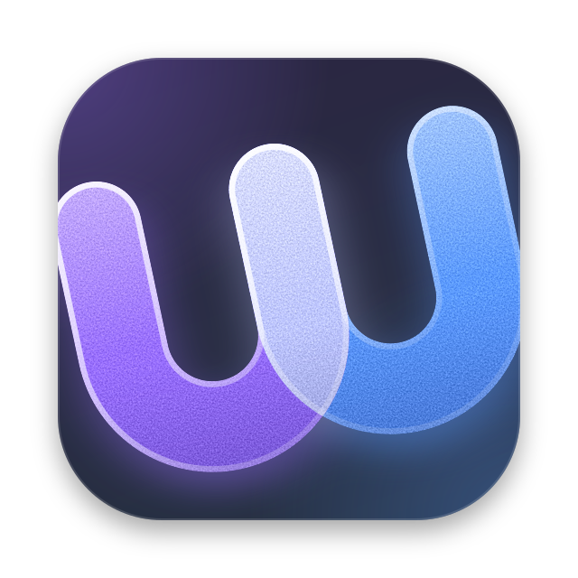

# Logo

Agreed on 2026-10-14, for now. It can still change.

The logo is a design asset. The browser build does not use it yet and still ships Chromium's icons.

  
  

## Files

| File | Use it on |
| --- | --- |
| [`assets/logo-light.svg`](assets/logo-light.svg) | Light backgrounds |
| [`assets/logo-dark.svg`](assets/logo-dark.svg) | Dark backgrounds |

- Each file is a 512 tile centered on a 640 canvas. The 64 margin holds the tile's drop shadow.
- These two files are the source. Copy them. Do not redraw the logo.
- The design canvas keeps the same drawing in its style guide `uw-logo`. Change both together.

## The mark

- Two u's share one stem. Together they read as a w: u, double u.
- Each u is one stroke with round ends. The first is violet and the second is blue.
- The shared stem takes a third color. It is darker than both inks on the light tile and lighter than both on the dark tile.
- The mark is tilted 12 degrees, rising to the right.
- It is zoomed until it runs about 3% past the tile's left and right edges. The tile clips it.

## Colors

| Role | Light tile | Dark tile |
| --- | --- | --- |
| Tile, 160 degree gradient | `#FDFCFF` to `#F1F4FE` | `#2B2542` to `#253242` |
| First u | `#7342F0` | `#9970FF` |
| Second u | `#4285F0` | `#5C9AFF` |
| Shared stem | `#1E22E2` | `#BEC6FF` |

The two inks sit 40 degrees of hue apart, at 257 and 217 degrees. These are the two hues of the default [window tint](plans/arc-style-look.md#scope).

## Geometry

In the mark's own units, before the tilt:

- Stroke 60. Space inside each u 60. Bowls are half circles with a radius of 60 on the center line.
- First u: `M24 30V116A60 60 0 0 0 144 116V30`
- Second u: `M144 30V116A60 60 0 0 0 264 116V30`
- Placement in the 512 tile: `translate(264.3 260.4) rotate(-12) scale(1.68) translate(-144 -100)`
- Tile corner radius: 22.5% of its width.

## Effects

Four effects sit on the flat mark. Their exact values are in the SVG files.

| Effect | What it does |
| --- | --- |
| Shaded | Each ink is lighter at the stem ends and deeper in the bowl. |
| Glass | A bright rim runs around each u. A soft shadow in the u's own color falls below it. |
| Grain | Fine grain in the inks. The rim sits above the grain and stays clean. |
| Wash | The tile is tinted violet from the top left and blue from the bottom right. |

Below about 32 pixels the grain, rim, and shadow are too fine to see. The shading and the wash remain.

## Not decided

- Using the logo as the app icon. The build still ships Chromium's icons. See [Customizing Chromium](../README.md#customizing-chromium).
- A wordmark.
- A one-color version.

## How it was chosen

The rounds of options are on the "Logo" page of the [design canvas](../AGENTS.md#designs).
